# StyleByFire

A local wardrobe and outfit studio built around your clothing photos. Plan a complete look, tune the styling rules, and keep notes about how each piece looks in real life.

## App preview

Screenshots from November 24, 2026, shared by the project owner. They show an example wardrobe; your account starts with your own clothing.

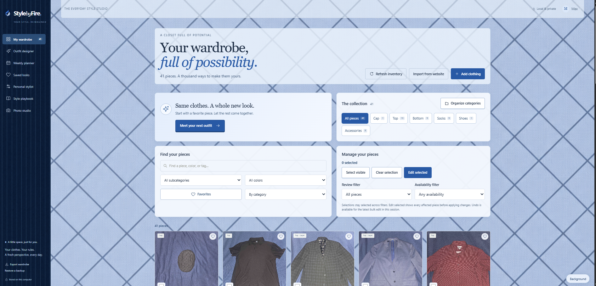

<details>
<summary>See all 11 screenshots</summary>

**Outfit designer and mannequin preview**

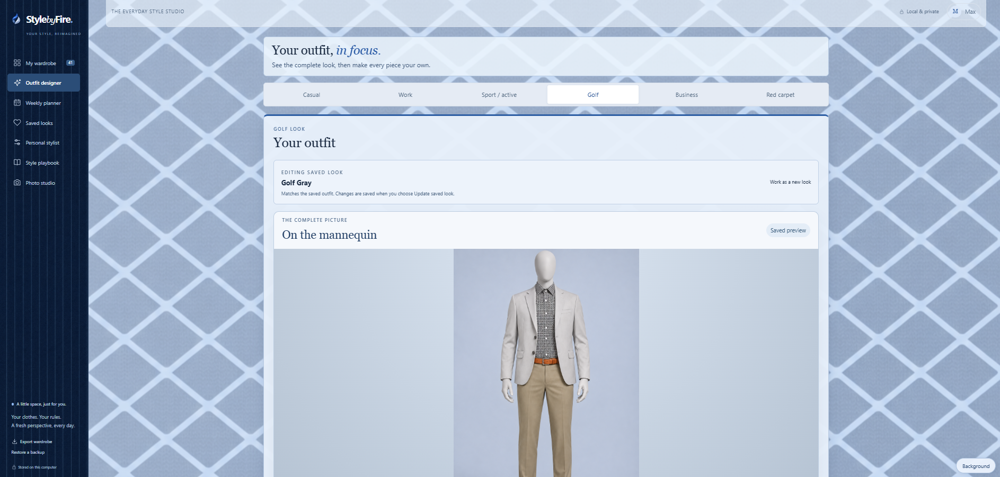

**Selected clothing and accessories**

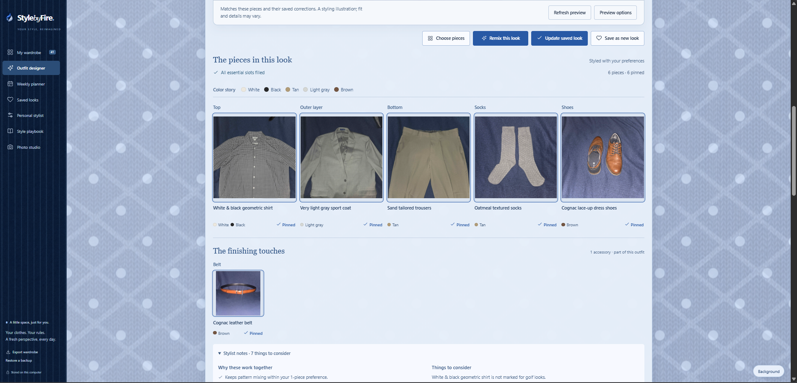

**Manual outfit builder and style notes**

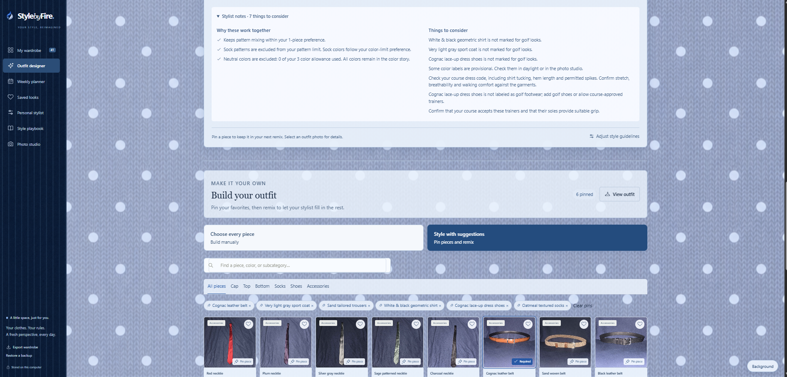

**Saved looks with mannequin previews**

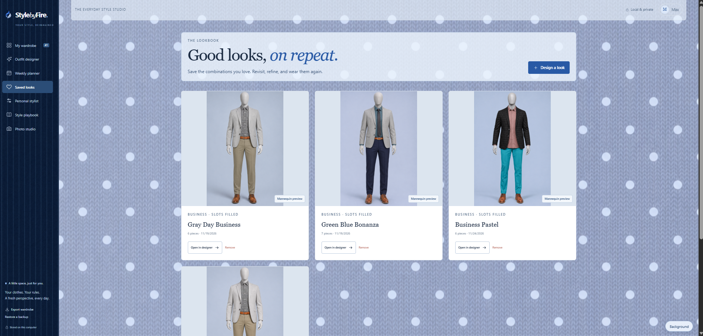

**Personal stylist preferences**

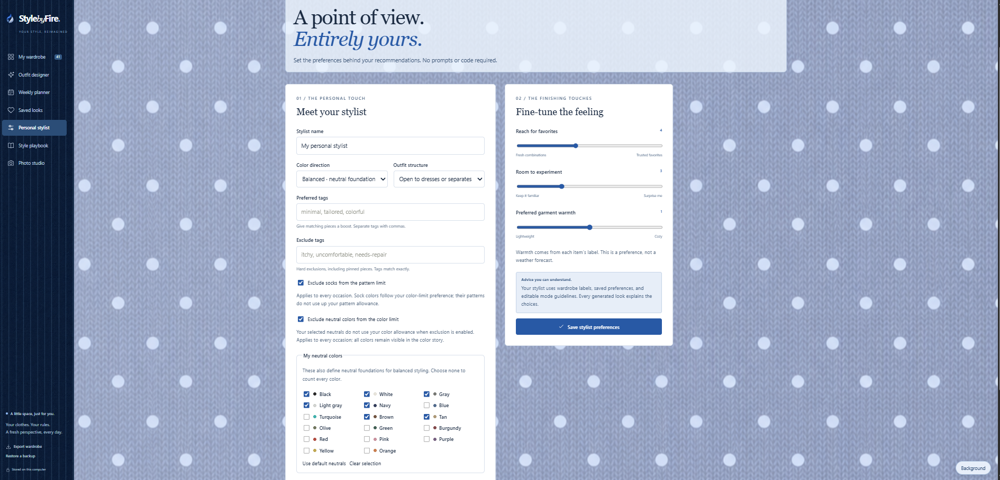

**Adjustable style playbook**

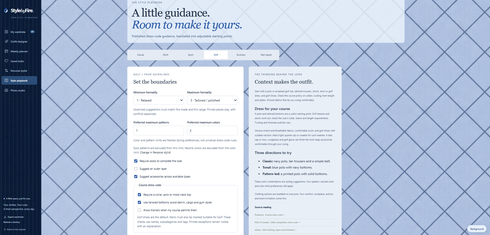

**Photo studio library**

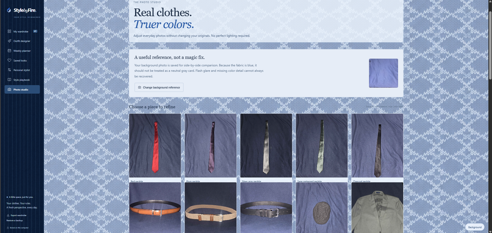

**Clothing photo color editor**

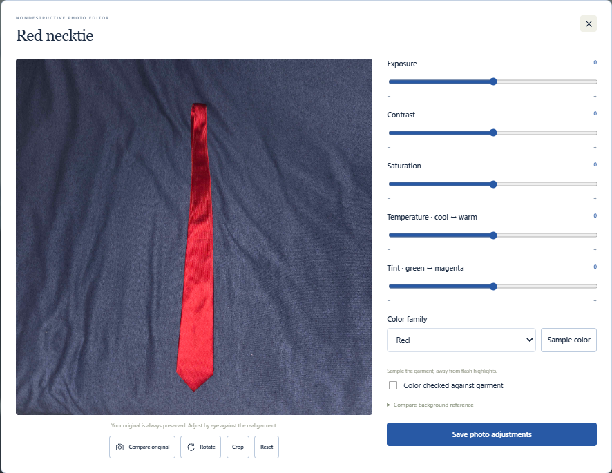

**Weekly planner settings**

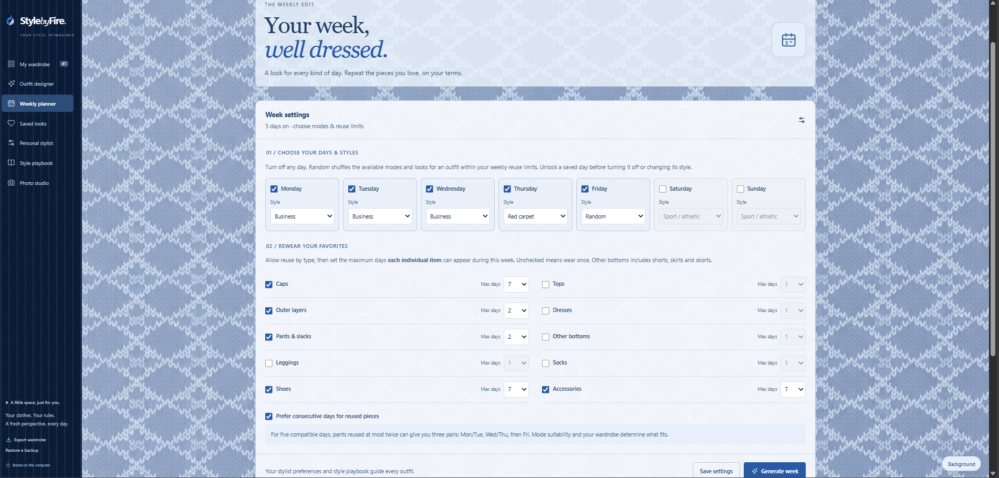

**Weekly outfits and mannequin requests**

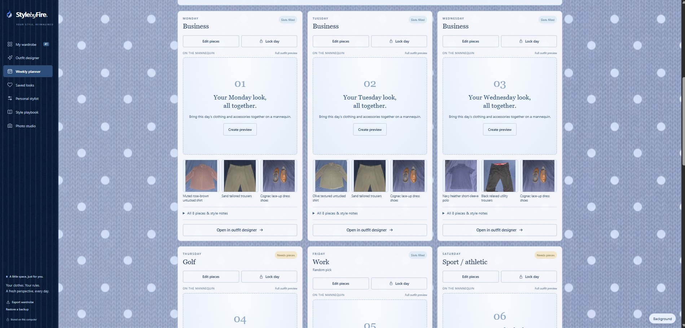

</details>

[Browse the original screenshots](preview/24_Nov_2026/)

## Run locally

Install **Node.js 22 or newer**, then run:

```sh
git clone https://github.com/MusicInTheTrees/StyleByFire.git
cd StyleByFire
npm start
```

Open **http://127.0.0.1:4173**. There are no npm packages to install and no build step. The server listens only on this computer; no cloud account or API key is needed. Saved wardrobes work offline. Importing from a website and loading the demo photographs for the first time require internet access.

On Windows, double-click **Start StyleByFire.cmd** instead. It starts the app in the background and opens Brave when installed, or your default browser otherwise. **Stop StyleByFire.cmd** stops the server without deleting saved data. The launcher handles an outdated desktop PATH and records startup details in `.data/launcher.log` and `.data/server.log`.

## Accounts and the test wardrobe

Create a local account with a display name, username, and password. Usernames use 3–32 letters, numbers, periods, underscores, or hyphens; passwords require at least 8 characters. Each account has its own wardrobe, photographs, saved looks, stylist preferences, and guidelines.

**Jamie Demo** is a clearly fictional person with a separate wardrobe of real product photographs from retailers. Use the demo option on the sign-in screen to try outfit combinations and accessories without changing your personal wardrobe. On first use, the app downloads the demo photographs and caches them locally under `.data/demo-photos/`; later use can reuse those files offline. Source links identify the retailers behind the photographs. A fresh clone includes demo labels and source URLs, not retailer image files or original personal clothing photographs. The README preview gallery contains owner-approved screenshots of an example wardrobe.

When upgrading an existing installation, the **first real account** claims the previous wardrobe, including corrections, notes, favorites, image adjustments, and saved looks. The server leaves `.data/wardrobe.json` untouched, makes an exact backup under `.data/backups/`, and copies the wardrobe and imported photos into the new account. Later accounts start with an empty wardrobe and import their own photos. Trying the demo does not claim the existing wardrobe.

Accounts live on this computer, with no email verification, cloud sync, or password recovery service. Passwords are stored as salted hashes and sign-in sessions use HTTP-only cookies. This separates access through the app; it does not encrypt files on disk or replace your operating system's account security. Keep a wardrobe backup and use a password you can retain safely.

The sign-in and registration forms support browser password managers, so you can save your login and autofill it later. Your browser controls whether a Save prompt appears; it is not guaranteed in every browser or profile. In Brave, enable **Offer to Save Passwords** in its Password Manager settings and check that this app is not in the declined-sites list. See [Brave's password-manager guide](https://support.brave.app/hc/en-us/articles/360018185951-How-do-I-use-the-built-in-password-manager). A successful local session lasts up to 30 days, so reopening the app normally keeps you signed in unless you sign out or clear its cookies.

## Set up the category tree

After sign-in, an account banner offers **Preview category tree** until you install it or choose **Not now**. Preview the full tree, then add its missing paths beneath Cap, Top, Bottom, Socks, Shoes, and Accessories. Existing custom categories, clothing, notes, colors, and saved looks stay intact. The setup is additive and can be repeated safely. **My wardrobe → Organize categories → Set up full category tree** reopens it after dismissal. Nested folders expand and collapse in Organize categories.

This is an in-app category tree, saved separately for each account; it does not create, move, or rename folders on disk. Dresses stay within Top, leggings within Bottom, and all accessory types remain beneath Accessories. Installation/dismissal is saved with the wardrobe, including backups.

## Plan a week

Open **Weekly planner** to choose which days need an outfit and select a mode for each: Casual, Sport / athletic, Golf, Business, Red carpet, or Random. The starting schedule is Monday–Wednesday Business, Thursday Red carpet, Friday Random, with Saturday and Sunday off and preset to Sport if enabled. **Save settings** keeps your preferences; **Generate week** saves the preferences and creates or regenerates unlocked outfits.

Enable reuse separately for caps, tops, outer layers, dresses, pants/slacks, other bottoms, leggings, socks, shoes, and accessories. The maximum is **total days per individual item within that plan**, from 1 to 7; unchecked means a single wear. Accessory limits apply separately to each tie, watch, wallet, necklace, and other piece. Pants are recognized from their subcategory (or name when uncategorized); shorts, skirts and skorts use Other bottoms. The fixed wardrobe categories stay the same.

**Prefer consecutive days** groups compatible repeats. With five compatible days and enough suitable clothing, a two-day pants limit can produce three pairs: Monday/Tuesday, Wednesday/Thursday, and Friday. Different modes can require different pieces, and skipped calendar days do not count as consecutive. The planner searches alternative combinations, considers future days, and never exceeds reuse limits to fill a gap. Random tries shuffled modes and favors an outfit it can complete within those limits. A limited wardrobe may produce incomplete days; their cards explain the missing pieces and possible adjustments.

Each day has clothing photos, every selected accessory, style notes, **Edit pieces**, and **Open in outfit designer**. Use Edit pieces, click a clothing photo, or choose Change beside an accessory to edit that day's selection directly. Search/filter the wardrobe, swap one piece, add accessories, or remove a piece, then **Save changes**. Cancel leaves the plan untouched. Swapping one accessory preserves the others; a dress replaces the separate top and bottom. Manual choices may differ from the day's styling guidelines, with warnings, but cannot add new reuse-limit violations or unavailable pieces. Partial outfits can be saved. Opening a day in the separate outfit designer still copies its selection; edits there do not rewrite the week.

**Lock day** keeps that day's pieces and resolved style mode when choosing **Regenerate unlocked days**, including days originally set to Random. Locked items are reserved before any unlocked day is generated, so a Friday lock cannot lose its reuse allowance to Monday. Unlock a day before turning it off or changing its scheduled mode. Locking an existing outfit restores its saved day/mode if those preferences had changed. Direct edits to a locked day remain possible and keep the lock. If the locked outfits alone exceed new reuse limits, generation explains the conflict and leaves the saved plan intact. A locked outfit that becomes incomplete or contains clothing moved to laundry stays selected with warnings until you edit or unlock it.

The rewear summary lists which days use each repeated piece. Your style playbook, color corrections, stylist exclusions, and clothing availability guide suggestions for unlocked days. The planner does not mark items worn, change laundry status, or generate AI images in bulk.

**Save week** keeps a named copy of the current outfits, day locks, and settings in your account (up to 100 weeks). Use **Open / edit** to bring one back into the planner, **Update saved week** to overwrite it, or **Save as new week** to keep a separate copy. You can rename or delete saved weeks. Opening another week or starting fresh asks before replacing your working plan. Deleting a named copy leaves the current working outfits intact.

Your working plan still autosaves when you generate, edit pieces, or lock days. Editing a named week does not overwrite its library copy until you choose Update saved week. When an account has a current plan, signing in or reopening the app opens the weekly planner. Named weeks are included in wardrobe backups and retain their day modes and locks; removing clothing also removes its references from named weeks. Available mannequin previews are matched again when a week is opened.

Settings, edits, day locks, and the latest plan belong to the signed-in account, survive restarts, and are included in wardrobe backups. Changing settings keeps the previous plan visible with a reminder to regenerate. Removing a clothing item removes its references from all weekly outfits, including locked days; current item warnings are reassessed when viewing the plan. Limits apply across the entire generated plan, including locked outfits; this is a reusable Monday–Sunday planner, not a dated calendar or wear-history tracker.

Each planned day also has a large **mannequin preview above its clothing pieces**. Saved images appear when they match that day's full selection, mode, photo edits, and styling/color corrections; select the image to enlarge it. Repeated outfits share a preview, and unchanged locked outfits keep their matching image when the week is regenerated. Editing a day clears an outdated image without deleting it from preview history.

Choose **Prepare week previews**, expand the Codex request, then **Copy week request** and send it to Codex. This prepares only missing valid outfits and combines repeated outfits into one request. Preparing references does not generate an image or call a billed API. The planner checks every five seconds while it is visible and shows completed images automatically. **Refresh previews** retries after a connection error. Each day's **Create preview / Preview options** opens the existing mannequin studio for that specific day, with shape choices and the optional configured local/API routes. Days missing a top and bottom or a dress, or containing unavailable pieces, explain what needs editing first. Preview requests/images stay in the account's mannequin history and are not part of wardrobe JSON backups.

## Build a look

- **Outfit designer:** choose Casual, Sport, Golf, Business, or Red carpet. The selected outfit is the primary workspace, with a large mannequin preview first and individual pieces above the clothing picker. A blue-and-gray interface keeps attention on your clothing's actual colors.
- **Build manually:** choose **Choose pieces** in Outfit designer, or select **Choose every piece** in the builder underneath the outfit. Click a photo to add or remove it immediately. Clothing replaces its occupied slot; a dress replaces the separate top and bottom while keeping leggings and outerwear. Accessories can be combined. Search by name, color, tag, or subcategory, start empty, or explicitly ask for suggestions to fill remaining slots. Manual choices still receive color stories and style notes. The current outfit is remembered in this browser separately for each account; save it to the lookbook for a named combination.
- **Pin required pieces:** create or remix around the items you want to wear. Conflicting pins and missing essentials are explained. New pins leave the current outfit visible until you remix it.
- **Combine accessories:** ties, belts, eyewear, earrings, necklaces, brooches, watches, wristbands, rings, wallets, and scarves can appear together. Automatic selection chooses eligible pieces across accessory types instead of stopping after one accessory. Ties include neckties, bow ties, and ascots; automatic selection avoids adding several ties at once. Common labels such as eye wear, earing, wrist bands, and scarfs are recognized. Pin multiple accessories when you want a specific combination.
- **See the reasoning:** the color story shows the outfit's color families. Stylist notes explain the choices and flag tradeoffs such as extra patterns, colors, or pieces outside a mode's guidelines.
- **Dresses and layers:** a Top with the Dress role fills both Top and Bottom. Outerwear stays under Top; leggings stay under Bottom and can form a base or an underlayer.
- **Save combinations:** keep complete or unfinished outfits in the lookbook. **Open in designer** opens a saved look in the manual builder, with its name and an unsaved-changes indicator. **Update saved look** replaces that entry's pieces, occasion, and optional name while preserving its identity and original creation date. **Save as new look** creates a separate entry and makes that copy the one you are editing. Canceling either save dialog keeps the edits in the designer. Saves are explicit; preparing or generating a mannequin never overwrites a saved look. The browser remembers which look you are editing across refreshes within that account. **Work as a new look**, **Start empty**, or opening a weekly outfit clears that connection.

The Personal stylist uses editable controls for favorite pieces, preferred and excluded tags, color direction, experimentation, warmth, and dresses versus separates. **Exclude socks from the pattern limit** applies to every occasion: sock patterns do not use the pattern allowance in suggestions or warnings, while their colors follow the color-limit preference. These preferences are off by default and saved separately for each account. **Exclude neutral colors from the color limit** omits the colors selected in **My neutral colors** (defaults: Black, White, Gray, Light gray, Navy, Brown, and Tan) from both color-limit warnings and recommendation penalties. Choose any palette colors as neutrals, clear the selection to count every color, or restore the defaults. Your selection also defines neutral foundations for balanced styling. All colors stay visible in the color story; tonal and expressive matching still consider them. The Style playbook lets you change each mode's formality range, color and pattern preferences, socks requirement, outer layer, and accessory suggestions. Recommendations are transparent rules, not a generative AI service. Freeform notes are a notebook; they do not automatically change the recommendation rules.

Business starts as business casual. A completed outfit means its essential slots are filled, not that it meets every workplace or event's dress code. Confirm formal requirements against the invitation or venue.

### Golf looks

Golf prefers polos with tailored bottoms and requires golf footwear by default. Its Style playbook adds adjustable collar, tailored-bottom and trainer controls. Names, subcategories and tags determine these checks; items must also have **Suitable for → Golf** selected. Pinned exceptions remain in the outfit with explanations. Missing golf footwear stays a visible gap, rather than being filled with dress shoes. Pattern limits, custom neutral colors, availability, saved looks and mannequin previews work with Golf too.

Older accounts and backups gain Golf defaults and initial suitability labels for recognizable polos, tailored bottoms and practical accessories. Existing notes, corrected colors, photos, saved looks and other occasion rules are preserved. Once Golf is present, manual suitability and guideline edits remain authoritative. New folder imports and demo pieces receive the same initial labels.

The playbook includes classic, tonal and patterned outfit ideas, plus source links reviewed November 20, 2026. [Pinehurst's course policy](https://www.pinehurst.com/faqs/) and [PGA of Canada's competition policy](https://files.pgaofcanada.com/files/pga/images/events/2026/policies/en/dress-code.pdf) inform the dress-code checks. [adidas' golf guide](https://www.adidas.com/us/blog/667683-what-to-wear-golfing-tips-and-recommendations) informs the comfort, layering and footwear guidance. [Fossil Trace's FAQ](https://fossiltrace.com/faqs/) illustrates less prescriptive course guidance. Course requirements vary; photos and labels cannot verify fabric performance, fit, grip or approval.

## Preview on a mannequin

**Saved looks** uses a completed mannequin preview as the card cover when it matches the look's pieces, accessories, occasion, photo edits, and styling/color corrections. Select the image to enlarge it. Looks without a matching finished image keep their original clothing collage, including when a preview cannot be loaded. Existing pending requests are checked while this page is visible; opening the lookbook never creates or generates previews.

Outfit designer puts the saved mannequin image first, with the selected clothing and accessories underneath. The image appears only when it matches the current pieces, occasion, photo edits, and saved color corrections. A changed selection clears any outdated image. In the manual builder, **Automatically prepare mannequin updates** is on by default and can be turned off separately for each account in this browser. After two seconds without another change, a valid top-and-bottom or dress selection is saved as a Codex-assisted request. Copy its message and send it to Codex. The app checks every five seconds while the designer is visible and automatically displays the matching completed image. It reuses existing results, stops checking on account/page changes, and resumes when you return. It never calls a billed image API or starts a local model as part of this setting. Use **Create mannequin preview** or **Preview options** to pick a straight, broad, or curved mannequin and prepare the current outfit; **Refresh preview** retries checking after a connection error or when automatic updates are off. When no working outfit is remembered in this browser, the latest completed preview supplies the starting selection. Preview history belongs to the signed-in account; opening an older preview shows its original outfit snapshot rather than silently substituting today's clothes.

Three generation routes are available:

- **Codex-assisted (default):** prepare the outfit, copy its request into a Codex chat with this repository open, then refresh after the generated image has been attached. This route does not require an API key and does not automatically run Codex from the browser. You can also attach a generated JPEG, PNG, or WebP yourself.
- **Local ComfyUI:** connect an installed local model and an API-format image-editing workflow. The app uploads all selected references to the loopback service, queues the workflow, and saves the output. This is an advanced setup route; StyleByFire does not bundle or install model weights. Readiness shows whether the configured local engine is running.
- **OpenAI API (optional):** enable a server API key to generate from the preview screen. This is separately billed and is never needed for the wardrobe or assisted route. Photos and styling corrections go to OpenAI only when Generate is pressed with this route selected. A configured key is shared by this local installation's signed-in accounts.

See [engine setup](docs/mannequin-engines.md) and the [ComfyUI workflow adapter guide](docs/comfyui-workflow-adapter.md). Keys stay on the server and are never returned to the browser. Missing configuration and provider failures produce actionable messages; requests can be retried without losing a saved result.

Previews use a private copy of the original clothing photos plus the saved color labels, descriptions, and styling corrections. Personal notes and stylist-profile notes are excluded. Photo-studio adjustments are retained in the snapshot for traceability but are not baked into the reference pixels; explicit color corrections guide the model. Every selected accessory remains in the reference list. Scarves drape around the neck; wallets may be concealed in a pocket in the generated image. Preview images are styling illustrations, not a prediction of exact fit, sizing, garment construction, or pattern reproduction.

Each account can keep 100 distinct outfit snapshots and up to 10 image versions per snapshot. Repeating identical inputs reopens the existing snapshot. Requests accept up to 20 pieces, with an OpenAI limit of 16 references; no route silently drops excess accessories. Download the displayed result to keep a separate copy. Mannequin snapshots and results live under the account's private mannequin folder and are not included in the wardrobe JSON backup.

For a local Codex assistant, inspect a request with `node scripts/mannequin.mjs <username> <preview-id>`. The output supplies its prompt and ordered reference paths without account credentials. Inspect all references, generate the actual image, then attach it with `node scripts/mannequin.mjs <username> <preview-id> <generated-image-file>`. This helper makes no model calls and preserves the original photos.

## App identity

The blue-and-silver **tailored flame** is the primary app icon, used in the browser tab, app wordmark, touch icon, and Windows icon file. The **SF monogram** is a secondary mark on the sign-in card and app footer. The approved original images are kept in `assets/branding/`; small browser assets and the multi-resolution Windows icon are exported into `app/`. On Windows, `scripts/build-brand-icons.ps1` rebuilds these exports without changing the original artwork. An existing desktop shortcut can use `app/stylebyfire.ico` as its icon.

## Background patterns

Four generated blue textile backgrounds—diamonds, linked geometry, lattice, and dots—keep the knit texture of the sock patterns that inspired them. The background stays fixed while the page scrolls. A lighter overlay makes the knit texture visible between readable outfit and text panels; a separate navy pinstripe fabric image covers the sidebar. By default, the main background changes every 18 seconds with a 6-second fade.

Open **Background** in the lower-right corner to choose **Slowly fade between patterns**, **Keep one pattern**, or **Solid blue background**. **Next pattern** selects another design. Automatic cycling pauses while the tab is hidden, and a reduced-motion browser preference keeps the background still. The chosen mode and manually selected pattern are saved in this browser's local storage, separately from account wardrobes. The complete image-generation prompts are in [background-prompts.md](docs/background-prompts.md).

## Manage clothing and photos

Import JPEG, PNG, or WebP images, up to 20 MB each. Convert HEIC files before importing. Each piece belongs to one of six fixed categories: **Cap, Top, Bottom, Socks, Shoes, Accessories**. Add slash-separated subcategories, tags, favorites, descriptions, color labels, warmth, formality, and occasion suitability.

**Import from a website** accepts a public HTTPS product-page URL or a direct JPEG, PNG, or WebP image URL. Preview the available product photos, choose one, and review the item's name, category, color, and other labels before importing it into your account. Each imported piece retains a source credit link. This imports one wardrobe item; it does not purchase products or automatically recognize a garment's type or true color.

Website previews use product information and sharing metadata published in the page, downloading up to six image choices into the signed-in account. Product pages are limited to 2 MB and each image to 20 MB. Some stores load their content with JavaScript or block automated access. If a page cannot be imported, try its direct image URL, or save an appropriate product photo yourself and use the normal photo importer. The app does not bypass sign-in requirements or site restrictions.

Open an item to rotate its image or add **Personal notes** and **Styling & color corrections**. These notes are saved with the article and included in backups, so an assistant can read them when you ask it to. Change the Color family field to correct matching; writing a note alone does not override the matcher. **Pattern / secondary color** records an optional second color, such as black geometry on a white shirt. Both colors appear in the color story, search and filters, and recommendations; the article still counts as one patterned piece.

Photo studio provides exposure, contrast, saturation, temperature, tint, rotation, cropping, original-image comparison, and color-family sampling. Adjustments are stored separately; original images are not rewritten. Starting a crop resets rotation and the previous crop so the crop coordinates remain predictable.

For an existing personal installation, **Refresh inventory** scans nested folders under `ClothingImages/`, adds new files, and preserves notes, corrected labels, favorites, rotations, and saved looks. This source-folder access belongs to the account that claims the original wardrobe. Other accounts, including Jamie Demo, import their own images instead.

## Work looks

**Work** is an adjustable everyday workwear occasion available in the outfit designer, weekly planner, saved looks, mannequin previews, and clothing editor. It starts with practical shirts/polos, trousers, socks, and suitable footwear; Business stays separate. Older wardrobes gain Work once, preserving their other occasions, notes, corrected colors, and custom guidelines. Later edits to Work suitability remain authoritative.

The category tree includes **Bottom / Pants / Work / Utility** and **Pants / Sport / Relaxed trousers** or **Utility trousers**. HeavyDuty folders import as utility work pants; Sport pants import as relaxed sport trousers. Review color and activity suitability against the actual garment.

## Wardrobe cleanup

Select pieces using the checkbox on each wardrobe photo, or filter the collection and choose **Select visible**. Selection persists across filters; the selected-piece list includes hidden selections. **Edit selected** supports bulk primary/secondary colors, patterns, verification, formality, warmth, favorites, subcategories, and suitable occasions. Unchanged fields keep their existing values.

- Add or remove tags across selected pieces, matching tags without case sensitivity.
- Append personal notes or styling corrections without replacing existing notes.
- Rotate selected photos by 90°, 180°, or 270° without rewriting originals.
- Find colors to verify, correction notes, missing subcategories, and missing occasions with **Review filter**.
- Mark pieces **Ready to wear**, **In laundry**, **Needs repair**, or **Archived**. Unavailable pieces stay saved, including photos and saved-look references; new suggestions skip them and pinned conflicts explain why.
- Preview before applying. **Undo last bulk edit** restores the last batch during the current session; it refuses to overwrite subsequent edits to affected pieces. Reloading or switching accounts clears that undo history. Export a backup for long-term recovery.

## Data, backups, and privacy

Account credentials and hashed session identifiers are stored in `.data/accounts.json`. Each account's wardrobe and imported photos live under `.data/accounts/<account-id>/`. Export a complete JSON backup from the app before moving to another computer or making major changes. It includes the signed-in account's photographs, labels, adjustments, preferences, and saved looks. Restore replaces that account's wardrobe after an explicit confirmation; it does not replace other accounts. A wardrobe backup is not an account-password backup.

Existing installations may also have original photos in `ClothingImages/`, a private catalog in `seed.json`, and small previews in `app/thumbs/`. These files, `.data/`, local QA files, and exported wardrobe backups are excluded from Git. The published repository contains application code, generated background artwork, demo metadata, and owner-approved preview screenshots. Original wardrobe files, notes databases, and full-resolution clothing imports stay local. Changing a seed catalog does not overwrite an already-saved wardrobe.

The wardrobe uses no analytics or remote fonts and needs no model API. Mannequin generation is optional: the API route sends selected photos and styling corrections to OpenAI, the local route sends them to the configured loopback ComfyUI service, and the assisted route uses the image service available in your Codex chat. ComfyUI keeps its own input/output copies outside the app account boundary; use a trusted local workflow and installation. Website imports and initial demo setup contact the selected retailers to download public pages or photos; retailers receive ordinary web requests. Clicking a source link also opens its external website. Downloaded product photos stay local, and their copyright remains with their respective owners. Attribution is not a license to redistribute them; retailer photos are not committed to this repository.

Use one editing tab per account: concurrent edits are not merged. Browser storage is not the source of truth.

## Photography and styling limits

Color adjustments and the nearest-color sampler are visual aids, not calibrated color measurements. A colored photo background is useful for comparison but is not a neutral gray card. Flash glare and clipped detail cannot always be recovered. Compare the garment in daylight; for repeatable accuracy, photograph a neutral gray card under the same light.

New imports start with unverified labels. Review color, pattern, formality, and modes before relying on recommendations. This version does not include automatic garment recognition, reusable garment cutouts, or measured virtual try-on. Mannequin previews generate an approximate view of the chosen outfit.

Styling defaults draw on [Emily Post's attire guide](https://emilypost.com/advice/attire-guide-dress-codes-from-casual-to-white-tie), [Emily Post's business-casual guide](https://emilypost.com/advice/business-casual-attire-guide), [REI's running-clothing guide](https://www.rei.com/learn/expert-advice/running-clothing.html), and the [Festival de Cannes event FAQ](https://www.festival-cannes.com/en/faq/). The latter illustrates event-specific requirements, not a universal red-carpet rule. Pattern and color-count limits are adjustable styling preferences.

## Development

Submit changes through a pull request targeting `main`. All files are owned by
`@MusicInTheTrees`, whose approval is required before merging. New changes dismiss
previous approvals, and review conversations must be resolved. The protection also
applies to administrators; force pushes and deletion of `main` are disabled.
GitHub does not allow authors to approve their own pull requests, so owner-authored
pull requests need an explicit owner decision about the review configuration.

```sh
npm test
node --check app/app.js
```

The automated tests cover outfit rules and accessory combinations, weekly schedules and per-item reuse limits, consecutive repeats and clothing shortages, weekly edits and day locks, per-day mannequin matching and shared requests, automatic preview refresh and stale-result handling, inventory refresh, custom neutral colors and bulk edits, account isolation, mannequin snapshots and provider contracts, website-import URL and DNS validation, redirect and response-size limits, product metadata, and real-photo demo upgrades and offline use. Provider tests mock image services; they do not require API spending or an installed local model. Integration tests use isolated temporary data directories rather than your saved wardrobe.

- `PORT` changes the listening port.
- `STYLEBYFIRE_DATA_DIR` selects a separate data directory for isolated QA.

Source is plain JavaScript, CSS, and HTML served by a small Node server. `app/domain.js` owns outfit rules and validation; `app/photos.js` owns non-destructive image rendering; `app/app.js` owns the interface. The Windows launchers and `scripts/launch.mjs` handle local startup and shutdown.
